# 실험 보고서 — 리튬이온 배터리 SOH·RUL 예측과 실차 데이터 적용 (v2, 감사 반영)

작성일 2026-10-14. 이 문서의 수치는 모두 `python -m experiments.run_all` 최종 실행(감사 반영본)에서 생성된 CSV/JSON에서 옮겼다. 감사 전 보고서·결과·코드는 `results_archive/v1_before_audit/`에 그대로 보관했다. 데이터 구조와 확보 과정은 [dataset_report.md](dataset_report.md)를 참고한다.

**성능 수치를 읽는 규칙.** 이 보고서의 "성능 주장"은 모두 **학습 데이터만으로 고른 모델의 테스트 성능**이다(`results/nasa/final_claims.csv`). 모든 후보 모델을 나열한 표는 비교용 기술 통계이며, 그 표에서 가장 좋은 값을 고르는 것(사후 선택)은 성능 주장으로 쓰지 않는다. 사후 최저값이 필요한 곳에는 "(사후, 기술 통계)"라고 표시했다.

## 0. 요약 — 조건별 결론

| 조건 | 학습 데이터로 선택한 모델 → 테스트 MAE | 사전 지정 기준선 | 결론 |
|---|---|---|---|
| 현재 SOH, 신호 특징, 시간순 | LinearRegression → **0.0239** | 직전 SOH(Persistence) 0.0046 | 직전 실측 용량을 알면 기준선이 6배 정확 |
| 현재 SOH, 신호 특징, 미학습 배터리(LOBO) | 배터리마다 RF/XGB/LR/XGB → **0.0374** (4-fold 평균) | Persistence 0.0057 | 미학습 배터리에서는 오차가 약 1.6배 증가 |
| Small Data (배터리당 처음 10~30회) | 0.149~0.259 (R² −5.3 ~ −17.8) | — | **신뢰할 수 있는 모델 없음** |
| 미래 +10 Cycle SOH | 시간순 XGB 0.0314 / LOBO XGB 0.0241 | 최근 20점 선형 외삽 0.0094 / 0.0180 | **단순 외삽이 선택된 ML보다 정확** |
| 미래 +20 Cycle SOH | 시간순 LR 0.0397 / LOBO XGB 0.0291 | 외삽 0.0143 / 0.0290 | 시간순은 외삽 우위, LOBO는 동률 |
| RUL (1.4 Ah) | 배터리별로 외삽(all)/XGB/XGB → 123.9 / 14.7 / 9.9 Cycle | — | 선택 규칙도 B0005 실패를 막지 못함 |
| NASA 모델 → 실차 EV10 | XGBoost(NASA LOBO로 선택) → 0.219 | NASA 평균 SOH 상수 0.140 | **적용 불가** |
| EV20 장기 추세 | (모델 아님) | — | 20대 모두 월 −0.53~−1.00 Ah 감소, 가속형 knee 미검출 |

감사로 달라진 핵심 결론은 다음 세 가지다.
1. v1 요약의 "미학습 배터리 LR 0.0242"는 테스트 결과를 보고 고른 값이었다. 학습 데이터만으로 고르면 **0.0374**이다.
2. Stacking을 시간 순서·배터리 그룹에 맞게 고치자 시간순 성능은 좋아졌지만(0.0193 → 0.0143), LOBO 성능은 나빠졌다(0.0265 → 0.0408). 시간순에서는 사후 기준으로 Stacking이 가장 낫지만, 학습 데이터로 하는 선택에서는 LR이 뽑혔다.
3. EV10 특징은 라벨과 **같은 충전 기록의 부분합**이다. v1의 "라벨을 복원하지 못한다"는 표현은 지나치게 강해서 철회했다(6절).

## 1. 연구 질문
1. NASA 셀의 현재 SOH를 충전 곡선·임피던스·Cycle 정보로 얼마나 정확히 추정할 수 있는가? 검증 방식에 따라 결론이 어떻게 달라지는가?
2. 학습 데이터가 적을 때(Small Data), 그리고 Stacking이 단일 모델보다 나은가?
3. 미래 10·20 Cycle의 SOH와 RUL(1.4 Ah 도달까지 남은 Cycle)은 실제 관측값 기준으로 어느 정도인가?
4. 실차 20대의 장기 용량 변화는 어떤 형태이며, 급격한 열화(knee)가 관측되는가?
5. NASA 셀로 학습한 모델을 실차 팩(EV10)에 그대로 적용할 수 있는가?

## 2. 실험 조건

### 2.1 데이터 단위와 라벨
- **NASA**: B0005, B0006, B0007, B0018. 한 행은 방전 1회(총 636행: 168/168/168/132).
  - 기본 SOH = `soh_init` = Cₖ/C₁.
  - 보조 SOH = `soh_rated` = Cₖ/2.0 Ah.
- **EV20**: 충전 세션 → 차량·월 단위로 집계. 라벨은 **SOC 기반 추정 용량**(∫I dt / ΔSOC)이며 측정된 SOH가 아니다.
- **EV10**: 차량당 1개, 총 10개 SOH 라벨. 라벨 = 기록된 전체 충전 Ah ÷ Cn이다(9/10대 일치, 차량 8은 0.0013 차이).

### 2.2 입력 특징 (NASA)
방전 k 행의 입력은 방전 k가 시작되기 전에 측정된 정보만 쓴다. 방전 k의 곡선은 정답(용량)을 복원하므로 쓰지 않는다.

| 그룹 | 특징 | 출처 |
|---|---|---|
| charge | CC 시간, CV 시간, 시작 전압, 3.9→4.1 V 도달 시간, 충전 중 평균·최고 온도, 온도 상승, dQ/dV 최댓값과 그 전압 | 직전 충전 |
| charge_ah | CC 충전량, 총 충전량 (≈ 직전 방전량, 사실상 이력 정보) | 직전 충전 |
| impedance | Re, Rct | 가장 최근 EIS |
| cycle | 방전 번호 k | |
| history | SOH(k−1), SOH(k−2), 최근 3회 평균, 최근 5회 기울기 | 방전 1..k−1 |

기본 특징 세트(A~D) = charge + impedance + cycle (14개).

### 2.3 전처리 규칙과 처리 건수 (`results/nasa/preprocessing_log.json`)
| 규칙 | B0005 | B0006 | B0007 | B0018 |
|---|---:|---:|---:|---:|
| 충전 샘플 중 비유한값 제외 | 0 | 0 | 0 | 0 |
| 불완전 충전(< 1.0 Ah) → 충전 특징 NaN | 2 | 2 | 2 | 3 |
| 직전 충전 없음 → 충전 특징 NaN | 1 | 1 | 1 | 0 |
| 이전 임피던스 없음 → Re/Rct NaN | 19 | 19 | 19 | 0 |
| 용량 ≤ 0 또는 NaN 행 제거 | 0 | 0 | 0 | 0 |

- 남은 NaN은 파이프라인 안의 중앙값 대치로 처리하고, 대치값은 학습 행에서만 계산한다(테스트로 확인).
- 학습 폴드에서 특징 값이 하나도 없으면(초기 Cycle만 있는 OOF 폴드 등, 실행 중 6회) 그 폴드의 모델은 해당 특징을 쓰지 않는다.

### 2.4 모델
- 후보: Linear Regression, Random Forest(300 trees), SVR(RBF, C=10, ε=0.05), XGBoost(400 trees, depth 3, lr 0.05), Stacking(앞의 4개 + RidgeCV 메타).
- 하이퍼파라미터는 사전에 고정했고, 어떤 테스트 세트로도 튜닝하지 않았다.
- 목표값은 학습 데이터의 평균·표준편차로 표준화한다.
- **Stacking의 OOF 방식 (감사로 변경, 3.0절):** 시간순 계열 실험은 forward(배터리별 시간 블록·확장 창), LOBO 계열은 group(배터리 단위 leave-one-out), Random split은 섞은 KFold를 쓴다.

### 2.5 데이터 분할
| 이름 | 정의 | 테스트 크기 |
|---|---|---|
| Random | 전체 행 70/30, 시드 5개 | 191행 |
| 시간순 | 배터리별 앞 70 % 학습 / 뒤 30 % 테스트 | 189행 |
| Small Data | 배터리별 처음 N회 학습, 테스트는 시간순과 같음 | 189행 |
| LOBO | 배터리 1개 전체를 제외하고 학습 | 132~168행 × 4 |

Random split은 같은 배터리의 인접 Cycle이 학습과 테스트에 섞여 성능을 과대평가하므로 대조용으로만 쓴다. B0005/6/7은 같은 시기에 같은 조건으로 시험되어 LOBO의 독립성이 낮다.

### 2.6 모델 선택 규칙 (감사로 추가, `src/evaluation/selection.py`)
| 시나리오 | 선택에 쓰는 데이터 | 방법 |
|---|---|---|
| 시간순·Small Data·미래(시간순) | 학습 구간만 | 배터리별 학습 구간의 뒤 20 %를 검증용으로 사용. 미래 예측은 검증 쌍의 출발 Cycle이 내부 학습 쌍의 목표 Cycle보다 뒤에 있어야 함 |
| LOBO 계열 | 학습 배터리만 | 학습 배터리끼리 leave-one-battery-out |
| RUL | 학습에 쓴 EOL 도달 배터리 2개 | 두 배터리를 서로 바꿔가며 검증. 교차 실패는 RUL 1000으로 간주 |
| EV10 | NASA 4셀만 | NASA LOBO로 선택하고, EV10 데이터는 선택에 쓰지 않음 |

후보 5개(Stacking 포함) 중 내부 검증 MAE가 가장 작은 모델을 고르고, 그 모델의 테스트 성능만 성능 주장으로 쓴다. 기준선(Persistence, 선형 외삽)은 사전에 지정한 비교 대상이며 선택 대상이 아니다.

## 3. 감사(Audit) 결과와 수정 내역

### 3.0 Stacking OOF가 시간 순서·배터리 그룹을 위반했는가 (`results/audit/stacking_cv_diagnosis.csv`)
v1은 sklearn `StackingRegressor(cv=KFold(5, shuffle=False))`를 썼다. 학습 행이 배터리 → Cycle 순으로 정렬되어 있으므로, 각 fold가 연속된 덩어리가 되어 배터리 경계와 시간을 가로지른다.

| 학습 세트 | OOF 방식 | 메타 학습 행 | 같은 배터리의 **미래 Cycle**로 학습한 모델이 만든 OOF 비율 | 같은 배터리를 본 모델이 만든 OOF 비율 |
|---|---|---:|---:|---:|
| 시간순(447행) | v1 KFold | 447 | **42.3 %** | 100 % |
| 시간순(447행) | v2 forward | 356 (첫 블록 제외) | 0 % | 100 % (과거만 봄, 실제 상황과 같음) |
| LOBO 4개 학습 세트 | v1 KFold | 468~504 | **52.8~60.3 %** | **100 %** |
| LOBO 4개 학습 세트 | v2 group | 468~504 | 0 % | 0 % |

- **판정:** v1은 테스트 행을 쓰지 않았으므로 **테스트 누출은 아니다**. 그러나 메타 학습기가 실제 평가 상황보다 쉬운 예측(시간 보간, 이미 본 배터리)으로 가중치를 배웠다. 그래서 시간순 외삽과 미학습 배터리 상황에 맞지 않는 결합이 학습되었다.
- **수정:** `OOFStackingRegressor`(`src/models/zoo.py`)를 만들었다.
  - **forward:** 배터리마다 학습 구간을 시간 블록 5개로 나눈다. 블록 j는 "라벨이 블록 j 시작 전에 확정된 행"만으로 학습한 모델이 예측한다. 미래 예측 쌍에서는 라벨 시점이 k+h이므로 그 기준을 적용한다.
  - **group:** 학습 배터리마다 leave-one-out으로 OOF를 만든다.
  - 최종 기저 모델은 학습 행 전체로 다시 학습한다.
- 시간 순서와 그룹 조건은 테스트 3개로 확인했다.

### 3.1 수정 전후 비교 (`results/audit/before_after_*.csv`)
**재현성:** 단일 모델 결과는 9개 표 모두 v1과 같다(최대 차이 5×10⁻¹⁵). 바뀐 것은 Stacking 행과 EV10 참고 행 이름뿐이다.

| 실험 | Stacking v1 → v2 (MAE) |
|---|---|
| A Random / 시간순 | 0.0094 → 0.0043 / **0.0193 → 0.0143** |
| B Small n=10/20/30/50/70/90 | 0.227→0.236, 0.105→0.196, 0.044→0.116, 0.112→0.087, 0.018→0.029, 0.037→0.025 |
| C LOBO B0005/B0006/B0007/B0018 (평균) | 0.0138→0.0225, 0.0429→0.0389, 0.0194→0.0181, 0.0300→**0.0838** (0.0265→**0.0408**) |
| 보조(정격 SOH) 시간순 / LOBO 평균 | 0.0162→0.0115 / 0.0293→0.0298 |
| 미래 +10 시간순 / LOBO | 0.0256→0.0405 / 0.0403→0.0337 |
| 미래 +20 시간순 / LOBO | 0.0318→0.0285 / 0.0492→0.0508 |
| E 특징 조합 18개 | 시간순 9개 모두 개선, LOBO 9개 중 6개 악화 |
| RUL B0005/B0006/B0018 | 21.3→26.5, 6.6→28.8, 18.0→8.7 Cycle |
| RUL B0007 관측 모순 비율 | 1 % → 40 % |
| EV10 3.90–4.00 / 3.95–4.05 V | 0.221→0.215 / 0.262→0.244 |

**해석:**
- Small Data에서 v1이 보였던 "n=30에서 Stacking 0.044" 같은 좋은 값은 시간 순서를 어긴 OOF 덕분이었다. v2에서는 0.116이다.
- 반대로 시간순 전체 학습에서는 메타 학습기가 외삽 상황에 맞는 가중치를 배워 성능이 좋아졌다.
- LOBO에서 나빠진 이유는 학습 배터리가 3개뿐이라 group OOF의 각 fold가 2개 배터리로만 학습되기 때문이다. 이렇게 배운 메타 가중치가 B0018에 맞지 않았다.

### 3.2 모델 선정과 테스트셋 사용 분리 (`results/nasa/final_claims.csv`)
v1 보고서 중 사후 선택이 성능 주장에 섞였던 곳과 수정 내용이다.

| v1 표현 | 문제 | v2 |
|---|---|---|
| 요약표 "미학습 배터리: LR 0.0242" | 4개 fold 평균 MAE를 본 뒤 LR을 고름 | 학습 데이터 선택 → **0.0374** |
| 요약표 "시간순: Stacking 0.0193" | 모든 후보 중 테스트 최저값을 인용 | 학습 데이터 선택 → LR **0.0239** (Stacking 0.0143은 사후·기술 통계) |
| C절 그림 제목 "최저 MAE … 모델" | 테스트 최저를 표시 | "학습 데이터로 선택: 모델 (MAE)"로 변경 |
| E절 "history 단독 LR 최고" | 특징 세트를 테스트로 비교 | 기술 통계로 명시. 특징 세트는 선택하지 않고 기본 세트를 미리 고정 |
| 미래 예측 "외삽이 최고" | 사전 지정 기준선과 모든 후보를 함께 순위 매김 | 선택된 ML vs 사전 지정 기준선으로 비교 |
| D절 "사후 최고 단일" | 명시는 되어 있었으나 요약에 섞임 | Stacking과의 비교 기준을 "학습 데이터로 선택한 단일 모델"로 바꾸고, 사후 값은 기술 통계 열로 분리 |

EV10 외부 평가에는 EV10 데이터를 선택이나 튜닝에 쓰지 않았다. 9개 하이퍼파라미터 설정도 사전에 고정했다. 따라서 테스트를 이용한 튜닝은 없다.

### 3.3 RUL 교차 실패를 MAE에서 뺄 때 (`results/nasa/rul_results.csv`)
v1은 교차 실패(1000 Cycle 안에 1.4 Ah 미도달) 시점을 MAE에서 빼면서 실패 건수만 별도 열에 두었다. v2는 다음을 함께 보고한다.
- 성공률
- 실패 건수
- 성공 시점만의 MAE
- 실패를 RUL 1000으로 셈한 MAE
- 모든 방법이 성공한 공통 시점의 MAE
- 음수 RUL 예측 건수

실패한 경우는 **B0005의 최근 30점 외삽 6/106회(성공률 94.3 %)** 하나뿐이다. 이 경우 성공 시점 MAE는 80.1, 실패를 반영한 MAE는 127.0, 공통 100개 시점 MAE는 80.1이다. 그래프에는 실패 시점을 ×로 표시했다.

### 3.4 그 밖의 감사 사항
- **선형 회귀 잔여 점검의 오류:** EV10 잔여 성분(R = y − x)을 x로 선형 회귀하는 점검을 추가했다가 철회했다. 이 회귀는 y를 x로 회귀한 것과 같은 모델(기울기만 +1)이라 오차가 정확히 같고, 독립적인 점검이 아니었다.
- **EV20 상관의 p-value:** 같은 차량의 세션들은 서로 독립이 아니므로 p-value는 과대평가된다. 근거로는 효과 크기와 차량 간 부호 일치만 쓴다.
- **파일 핸들:** JSON 저장 시 파일 핸들이 닫히지 않던 경고(ResourceWarning)를 수정했다. 결과에는 영향이 없다.
- **sklearn 경고:** 병렬 실행 설정 전파 경고(`delayed`/`Parallel`)가 로그에 반복된다. 결과에는 영향이 없다.

## 4. 결과 — NASA 현재 SOH

### 4.1 실험 A: Random vs 시간순 (`exp_A_split_comparison.csv`, 모든 후보 · 기술 통계)
| 모델 | Random MAE (5회) | 시간순 MAE | 시간순 R² | 학습시간 (s) | 예측시간 (s) |
|---|---|---:|---:|---:|---:|
| LinearRegression | 0.0103 ± 0.0006 | 0.0239 ← 학습 데이터로 선택 | 0.763 | 0.005 | 0.001 |
| RandomForest | 0.0067 ± 0.0008 | 0.0322 | 0.601 | 0.27 | 0.05 |
| SVR_RBF | 0.0049 ± 0.0003 | 0.0378 | 0.214 | 0.02 | 0.003 |
| XGBoost | 0.0057 ± 0.0006 | 0.0290 | 0.636 | 0.16 | 0.002 |
| Stacking (v2) | 0.0043 ± 0.0005 | 0.0143 (사후 최저) | 0.914 | 2.4 | 0.06 |
| Persistence(lag1) | 0.0056 ± 0.0002 | 0.0046 | 0.985 | — | — |

- 시간순에서 학습 데이터로 고른 모델의 성능은 **LR 0.0239**이다. 내부 검증 MAE는 LR 0.0098, Stacking 0.0135였다(`final_claims.csv`).
- Random split은 모든 모델을 0.004~0.010으로 과대평가한다.
- Persistence는 직전 방전 용량을 실측해야 쓸 수 있다.

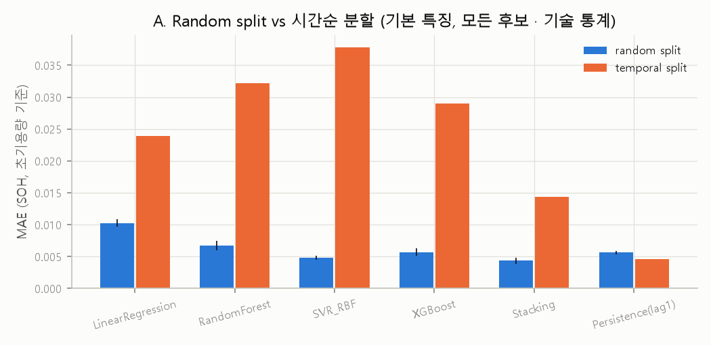

### 4.2 실험 B: Small Data (`exp_B_small_data.csv`)
| N | 학습 데이터로 선택 → 테스트 MAE | Stacking v2 (기술 통계) | 사후 최저 (기술 통계) |
|---|---|---:|---|
| 10 | LR → 0.176 (R² −7.9) | 0.236 | LR 0.176 |
| 20 | SVR → 0.259 (R² −17.8) | 0.196 | Stacking 0.196 |
| 30 | LR → 0.149 (R² −5.3) | 0.116 | Stacking 0.116 |
| 50 | Stacking → 0.087 (R² −1.3) | 0.087 | LR 0.014 |
| 70 | LR → 0.042 (R² 0.43) | 0.029 | Stacking 0.029 |
| 90 | LR → 0.037 (R² 0.55) | 0.025 | Stacking 0.025 |
| 전체(70 %) | LR → 0.024 (R² 0.76) | 0.014 | Stacking 0.014 |

- N ≤ 50에서는 선택된 모델의 R²가 모두 음수다. 즉 테스트 평균을 그대로 맞히는 것보다 못하다.
- 오차가 N에 따라 단조롭게 줄지 않고 선택 결과도 흔들린다. 적은 데이터로 먼 미래 Cycle을 외삽하는 문제는 단일 실행으로 순위를 정할 수 없다.

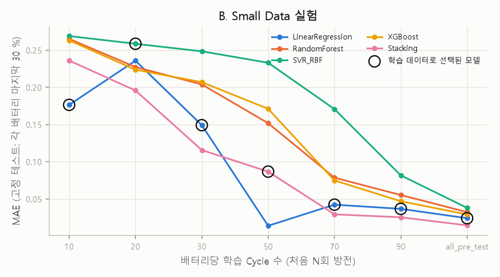

### 4.3 실험 C: Leave-One-Battery-Out (`exp_C_lobo.csv`)
| 미학습 배터리 | 학습 데이터로 선택 → MAE | LR | RF | SVR | XGB | Stacking v2 | Persistence |
|---|---|---:|---:|---:|---:|---:|---:|
| B0005 | RF → 0.0184 | 0.011 | 0.018 | 0.020 | 0.017 | 0.023 | 0.004 |
| B0006 | XGB → 0.0509 | 0.041 | 0.051 | 0.109 | 0.051 | 0.039 | 0.007 |
| B0007 | LR → 0.0236 | 0.024 | 0.024 | 0.018 | 0.020 | 0.018 | 0.004 |
| B0018 | XGB → 0.0569 | 0.022 | 0.026 | 0.056 | 0.057 | 0.084 | 0.008 |
| **평균** | **0.0374** | 0.0242 (사후 최저) | 0.0299 | 0.0505 | 0.0362 | 0.0408 | 0.0057 |

- B0006은 SOH가 0.57까지 내려가 다른 셀의 학습 범위(초기용량 기준 최저 약 0.69)를 벗어난다. 그래서 SVR은 약 0.83에서 포화하고, 트리 모델은 약 0.70 아래로 예측하지 못한다.
- 내부 LOBO가 고른 모델은 4개 fold **모두에서** 실제 미학습 배터리의 최적 모델(사후: LR, Stacking, SVR, LR)과 달랐다. 배터리 3개로 하는 선택은 신뢰도가 낮다.

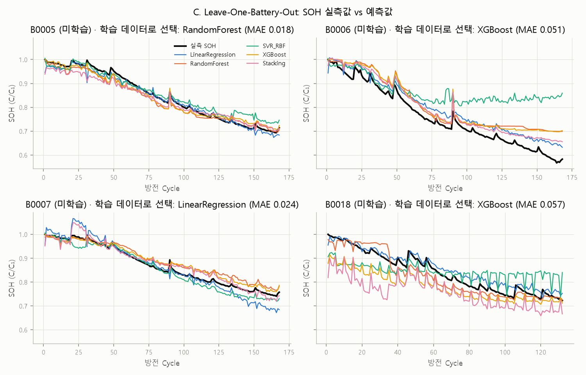

### 4.4 실험 D: Stacking vs 단일 모델 (`exp_D_stacking_vs_single.csv`)
비교 기준은 Stacking을 후보에서 뺀 채 **학습 데이터로 선택한 단일 모델**이다.

| 설정 | Stacking v2 | 학습 데이터로 선택한 단일 | 차이 | 단일 평균 |
|---|---:|---|---:|---:|
| 시간순 | 0.0143 | LR 0.0239 | −0.0096 | 0.0307 |
| LOBO 평균 | 0.0408 | RF/XGB/LR/XGB 0.0374 | +0.0034 | 0.0352 |
| Small n=10 / 30 / 50 | 0.236 / 0.116 / 0.087 | LR 0.176 / LR 0.149 / SVR 0.233 | +0.060 / −0.034 / −0.146 | |

- **결론:** OOF를 시간 순서에 맞게 만들면 시간순 외삽에서는 Stacking이 유리하다. 미학습 배터리에서는 학습 배터리가 적어 오히려 불리하다.
- 비용: Stacking 학습시간은 약 2~3 s로 단일 모델(0.005~0.27 s)의 10배 이상이다.

### 4.5 실험 E: 특징 조합 (`exp_E_feature_sets.csv`, 기술 통계)
| 특징 세트 | 시간순 사후 최저 | LOBO 사후 최저 |
|---|---|---|
| charge | Stacking 0.0155 | RF 0.0320 |
| impedance | Stacking 0.0470 | XGB 0.0614 |
| cycle | RF 0.0488 | XGB 0.0526 |
| charge+impedance | Stacking 0.0179 | RF 0.0339 |
| 기본(charge+impedance+cycle) | Stacking 0.0143 | LR 0.0242 |
| 기본+charge_ah | Stacking 0.0129 | RF 0.0317 |
| history | LR 0.0039 | LR 0.0065 |
| 기본+history | Stacking 0.0132 | RF 0.0122 |
| 전체 | Stacking 0.0116 | RF 0.0135 |

- 신호 그룹 중에서는 충전 곡선이 가장 유용하고, 임피던스 단독은 약하다.
- 과거 용량 이력이 있으면 그것만으로 거의 충분하다. 다만 이력은 매 Cycle 완전 방전으로 용량을 측정해야 얻을 수 있다.
- 특징 세트는 테스트로 고르지 않았다.

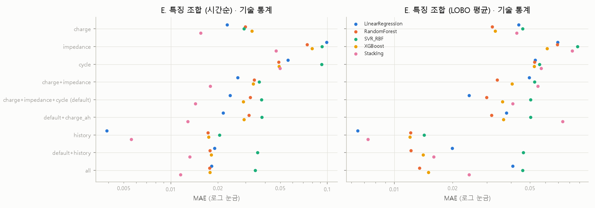

### 4.6 보조: 정격 기준 SOH (`supp_soh_rated_target.csv`, 기술 통계)
LOBO 사후 최저는 XGB 0.0196, 시간순 사후 최저는 Stacking 0.0115이다. 목표 정의를 바꾸는 것만으로도 순위가 달라진다.

## 5. 결과 — 미래 SOH와 RUL

### 5.1 미래 10·20 Cycle SOH (`future_soh.csv`, `final_claims.csv`)
| h | 검증 | 학습 데이터로 선택 → MAE | 선형 외삽(최근 20점) | Persistence | Stacking v2 (기술 통계) |
|---|---|---|---:|---:|---:|
| 10 | 시간순 | XGB → 0.0314 | **0.0094** | 0.0175 | 0.0405 |
| 10 | LOBO | XGB×4 → 0.0241 | **0.0180** | 0.0232 | 0.0337 |
| 20 | 시간순 | LR → 0.0397 | **0.0143** | 0.0300 | 0.0285 |
| 20 | LOBO | XGB×4 → 0.0291 | **0.0290** | 0.0406 | 0.0508 |

- 사전 지정 기준선인 단순 선형 외삽이 선택된 ML 모델보다 정확하거나 같다.
- 시간순 검증에서는 학습 쌍의 목표 Cycle이 분할 시점 이전이고 테스트 쌍의 출발 Cycle이 그 이후다. Stacking의 OOF와 모델 선택에도 같은 규칙을 적용했다(테스트로 확인).
- LR과 Stacking은 미학습 B0007에서 SOH를 최대 약 1.2까지 과대 예측했다.

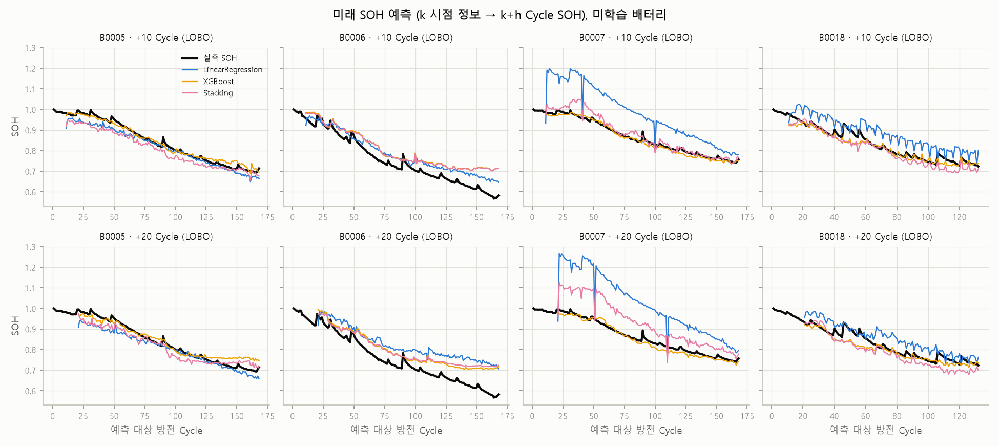

### 5.2 RUL (`rul_results.csv`, `rul_eol.json`)
- **EOL**(1.4 Ah 이하 첫 방전): B0005 #125, B0006 #109, B0018 #97.
- **B0007**은 168회까지 미도달이라 정답 RUL을 만들지 않았다. "예측 EOL ≤ 168"이면 관측과 모순으로 판정한다.
- 예측 시점은 k ≥ 20이고, ML은 EOL에 도달한 다른 두 배터리로 학습했다.

| 배터리 | 방법 | 성공률 | 실패 | MAE (성공만) | MAE (실패=1000) | 공통 시점 MAE | 음수 예측 |
|---|---|---:|---:|---:|---:|---:|---:|
| B0005 | 외삽(전체) | 100 % | 0 | 123.9 | 123.9 | 95.0 | 0 |
| B0005 | 외삽(최근30) | **94.3 %** | **6/106** | 80.1 | 127.0 | 80.1 | 0 |
| B0005 | ML-XGB / RF / SVR / LR / Stacking | 100 % | 0 | 12.9 / 13.0 / 15.0 / 20.9 / 26.5 | 같음 | 13.0 / 13.0 / 14.2 / 20.9 / 26.4 | 0 / 0 / 0 / 22 / 29 |
| B0006 | 외삽(전체) / 외삽(최근30) | 100 % | 0 | 9.3 / 15.8 | 같음 | 같음 | 0 |
| B0006 | ML-LR / SVR / RF / XGB / Stacking | 100 % | 0 | 5.8 / 12.1 / 14.6 / 14.7 / 28.8 | 같음 | 같음 | 6 / 0 / 0 / 1 / 44 |
| B0018 | 외삽(전체) / 외삽(최근30) | 100 % | 0 | 8.0 / 28.8 | 같음 | 같음 | 0 |
| B0018 | ML-Stacking / XGB / RF / LR / SVR | 100 % | 0 | 8.7 / 9.9 / 12.0 / 17.1 / 19.3 | 같음 | 같음 | 0 |

| B0007 (중도절단) | 외삽(전체) | 외삽(30) | LR | RF | SVR | XGB | Stacking |
|---|---:|---:|---:|---:|---:|---:|---:|
| 관측과 모순되는 예측 비율 (149개 시점) | 63 % | 64 % | 1 % | 93 % | 99 % | 94 % | 40 % |

**학습 데이터로 선택한 RUL 방법(성능 주장):**
- B0005 → 외삽(전체), 123.9 Cycle. 학습 배터리 B0006/B0018에서는 외삽이 가장 좋았지만, B0005의 초기 용량 회복 구간에서 실패했다.
- B0006 → XGB, 14.7 Cycle.
- B0018 → XGB, 9.9 Cycle.
- 평균 49.5 Cycle. 모든 선택이 교차에 성공했다.

ML은 학습 배터리가 2개뿐이라, 같은 방법도 배터리마다 순위가 크게 달라진다. Stacking은 학습 배터리 2개로 만든 group OOF 때문에 **음수 RUL**(물리적으로 불가능)을 B0005에서 29회, B0006에서 44회 예측했다.

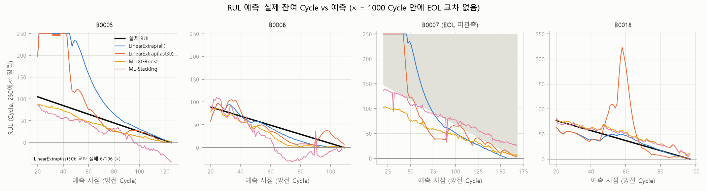
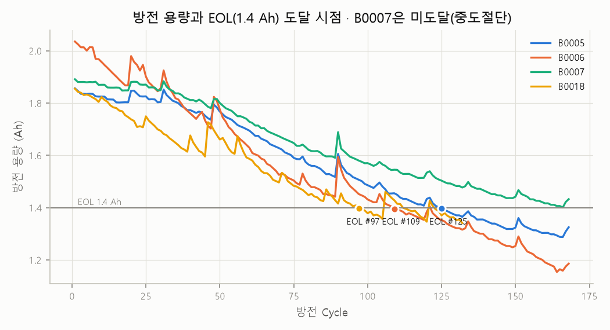

## 6. 결과 — EV10 외부 평가

### 6.1 라벨 종속성 (`ev10_label_dependency.csv`, `ev10_run_config.json`)
1. **라벨은 충전 기록에서 계산된 값이다.** SOH = 기록된 전체 충전 Ah / Cn이다(10대 중 9대 일치, 차량 8은 0.0013 차이). 측정된 방전 용량이 아니다.
2. **라벨이 0~100 % 전체 범위를 덮지 않는 차량이 있다.** 차량 2(4–100 %), 3(3–99 %), 5·8(0–99 %), 6(1–99 %)은 기록 범위가 전 구간에 못 미친다. 이런 차량의 라벨은 "전 용량"이 아니라 기록된 SOC 범위의 충전량이다.
3. **특징은 라벨 분자의 부분합이다.** 특징 = 3.90~4.00 V 창 충전 Ah / Cn이고, 라벨 = (창 충전 Ah + 나머지 충전 Ah) / Cn이다. 같은 기록이고 같은 분모(Cn)다. 특징이 라벨 분자에서 차지하는 비중은 8.3~13.9 %이며, 9대 모두 특징 < 라벨이다(테스트로 확인).
4. **상관관계(n = 9):**

| 관계 | Spearman ρ |
|---|---:|
| 창 충전 Ah ↔ 전체 충전 Ah (분모 제거) | **0.92** (팩 크기라는 공통 규모 효과) |
| 특징 ↔ 라벨 (둘 다 Cn으로 정규화) | −0.12 |
| 특징 ↔ 라벨에서 특징을 뺀 나머지 | −0.30 |
| 1/Cn ↔ 특징 (공통 분모 효과) | −0.44 |
| 1/Cn ↔ 라벨 | −0.14 |

**v1 주장 수정:**
- v1의 "전압창이 8~14 %만 덮어 특징이 라벨을 복원하지 못하게 했다"는 **지나치게 강한 표현이었다**.
- 창을 좁히면 "특징 = 라벨"은 피할 수 있다. 그러나 특징과 라벨은 같은 충전 기록·같은 분모에서 나오므로 **구조적으로 독립일 수 없다.**
- 정확한 진술은 다음과 같다.
  - **(a) 훈련–테스트 누출은 없다.** NASA 모델의 학습과 선택에 EV10 데이터와 라벨을 쓰지 않았다.
  - **(b) 라벨 종속성은 있다.** 외부 평가는 독립적으로 측정된 용량에 대한 검증이 아니다.
  - **(c) EV10만으로 한 LOO 적합(MAE 0.059, R² −0.49)은** 라벨의 일부를 특징으로 쓰는 구조이므로 성능 근거로 쓸 수 없다. 이 값은 비교용으로만 남겼다.
- 50 % 상한 장치(`MAX_LABEL_FRACTION`)는 종속성을 없애는 장치가 아니다. 특징이 라벨의 대부분이 되는 것만 막는다.

### 6.2 도메인 비교 (`ev10_nasa_comparison.csv`)
| 항목 | NASA | EV10 |
|---|---|---|
| 대상 | 단일 셀, 정격 2.0 Ah, 화학계 미기재 | 팩 84~108직렬, Cn 100~234 Ah, NCM |
| 전압 | 셀 단자전압 | 셀 평균전압 Vmean |
| 충전 C-rate | 0.75 C | 충전량 가중 0.27~0.38 C |
| SOH 정의 | 방전 용량 / 2.0 Ah | 기록된 충전 Ah / Cn |
| 라벨 수 | 636 | 10 (평가 9: 차량 5는 라벨 불일치로 제외, 게다가 Vmean 최대 3.993 V로 전압창 미포함) |

### 6.3 직접 적용 결과 (`ev10_external_eval.csv`, 3.90–4.00 V, n = 9)
| 모델 | NASA LOBO 검증 MAE | EV10 MAE | R² | Spearman |
|---|---:|---:|---:|---:|
| **XGBoost (NASA LOBO로 선택)** | 0.0302 | **0.219** | −12.0 | −0.02 |
| LinearRegression | 0.0353 | 0.208 | −11.0 | −0.12 |
| RandomForest | 0.0309 | 0.216 | −11.5 | +0.27 |
| SVR_RBF | 0.0306 | 0.229 | −13.2 | −0.22 |
| Stacking (group OOF) | 0.0307 | 0.215 | −11.7 | −0.25 |
| 기준선: NASA 평균 SOH 상수 | — | **0.140** | −4.9 | — |

3.95–4.05 V 창에서도 선택 모델은 XGB이고, MAE 0.229(전체 범위 0.227~0.275)로 결과가 같다.

**실패 원인:**
1. 같은 SOH라도 특징값이 다르다. EV10 0.084~0.126, NASA 신품 0.19~0.24 / 말기 0.02~0.10이다. 그래서 9대 모두를 0.69~0.76으로 예측했다. 특징값이 NASA 범위 안에 있어서 겉으로는 외삽처럼 보이지 않지만, 같은 값이 다른 의미를 갖는다.
2. 충전 곡선의 모양이 다르다. 0.75 C 단자전압은 분극 때문에 바로 3.8 V로 뛰지만, 0.3 C 셀 평균전압은 SOC에 따라 거의 직선으로 오른다.
3. 라벨 10개 중 평가 가능한 것은 9개이고 라벨 종속성까지 있어, 보정을 해도 신뢰할 수 있게 검증할 방법이 없다.

**결론: 적용 불가.**

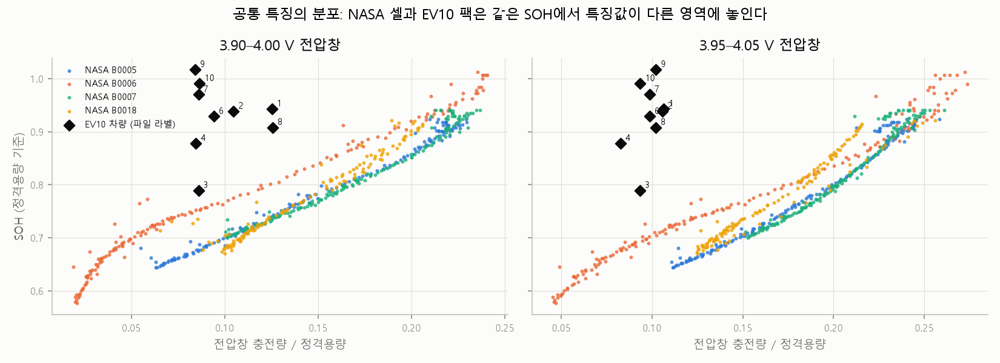
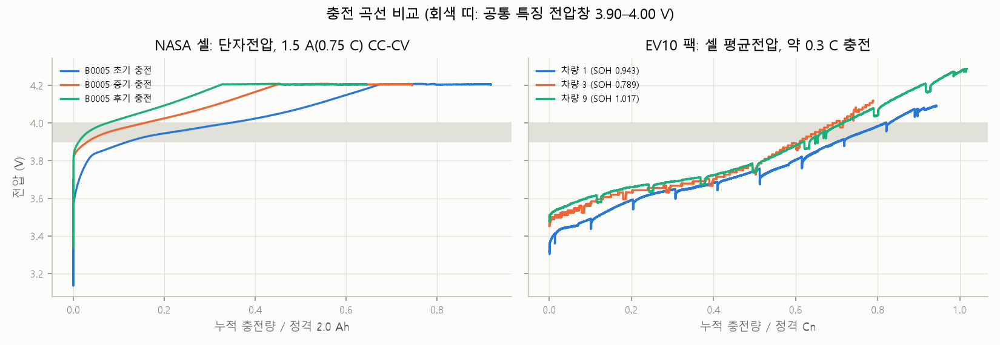

## 7. 결과 — EV20 실차 20대 (감사 전후 동일)

### 7.1 처리 규칙과 건수 (`ev20_filter_log.csv`)
16,100,728행 → 완전 중복 36,923행 제거(값이 다른 중복 0건) → 충전 세션 84,293개. 용량 추정 대상은 아래 필터를 차례로 적용했다.

| 단계 | 남은 세션 |
|---|---:|
| 100행 이상 | 54,911 |
| SOC +2 % 점프·−0.1 % 하락 없음 | 54,895 |
| ΔSOC ≥ 30 % | 14,192 |
| 양(+) 전류 없음 | 14,191 |
| 용량 72.5~159.5 Ah | **14,189** |

월별 집계는 세션 5개 이상인 달만 썼다(561 차량-월).

### 7.2 용량 변화
- **첫 3개월 → 마지막 3개월:** 차량별 중앙값 평균 133.2 → 115.2 Ah. 변화율 −10.7~−18.4 %(중앙값 −13.4 %). 공칭 대비 0.75~0.82.
- **선형 추세:** 월 −0.53~−1.00 Ah, R² 0.81~0.99. 초기 대비 연 4.8~8.9 %.
- **누적 충전량 기준:** 28개월 동안 등가 완전충전 621~768회. 100회당 −2.1~−3.9 Ah.
- **온도 보정 후에도** 기울기는 거의 같다(평균 −0.696 → −0.701 Ah/월). 계절성 잔차는 ±1 Ah 정도다.

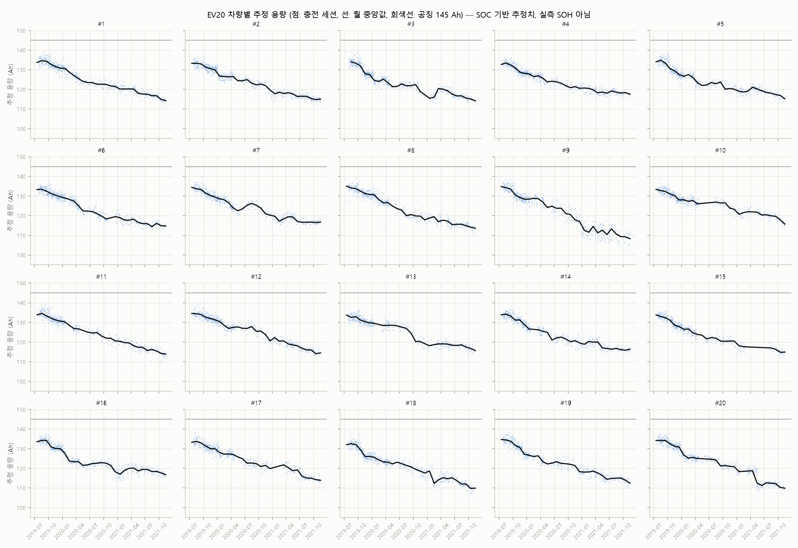

### 7.3 세션 특징과의 관계 (14,189세션)
| 특징 | 추정 용량과 ρ | 같은 달 중앙값 대비 잔차와 ρ | 잔차 부호가 같은 차량 |
|---|---:|---:|---:|
| 평균 C-rate | −0.50 | −0.15 | 20/20 |
| 충전 시간 | +0.53 | −0.01 | 14/20 |
| 시작 SOC | −0.03 | **+0.38** | 20/20 |
| ΔSOC | +0.26 | −0.07 | 16/20 |
| 팩 최고온도 | +0.05 | +0.07 | 20/20 |

- 같은 달 안에서 시작 SOC가 높을수록 추정 용량이 크게 나온다. **BMS SOC 오차가 추정치에 섞여 있다**는 근거로 해석했다.
- p-value는 세션이 서로 독립이 아니라서 사용하지 않는다.

### 7.4 Knee
- **기준:** ΔBIC ≥ 10, 꺾인 뒤 기울기 2배 이상 가속, 온도 보정 자료에서도 성립, 겨울 경계 제외.
- **결과: 20대 모두 미검출.** 11대는 ΔBIC ≥ 10이지만 모두 꺾인 뒤 기울기가 더 완만한 감속형이었다.

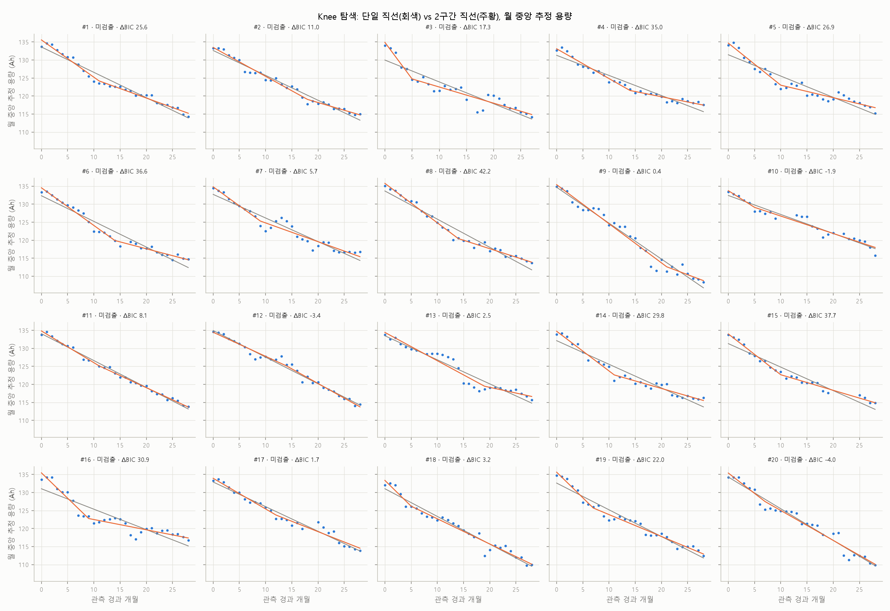

## 8. 실행 기록과 검증

### 8.1 실행 시간 (`results/runtime.json`, Intel64 CPU, Python 3.12.4)
| 단계 | 시간 (s) | 결과 |
|---|---:|---|
| Stacking OOF 진단 | 3 | 성공 |
| NASA 실험 (A~E·미래·RUL·모델 선택) | 338 | 성공 |
| EV20 분석 | 128 | 성공 |
| EV10 외부 평가 | 27 | 성공 |
| v1/v2 비교 | 1 | 성공 |
| pytest | 16 | **34 passed** |
| 합계 | 512 | |

NASA 단계가 v1(292 s)보다 길어진 이유는 시나리오마다 학습 데이터 내부 모델 선택을 추가했기 때문이다.

### 8.2 자동 테스트 (34개, `results/tests/pytest_output.txt`)
기존 25개에 감사용 테스트 9개(`tests/test_audit.py`)를 추가했다. v1의 EV10 테스트 1개("라벨과 0.3 이상 차이")는 근거가 약해 다음 테스트로 교체했다.

| 대상 | 확인 내용 |
|---|---|
| 누출 | 미래 Cycle을 잘라내도 특징이 같은지(prefix 불변성), 현재 방전을 바꿔도 특징이 변하지 않는지, 이력 특징이 한 칸 밀려 있는지 |
| 분할 | 시간순·Small Data·LOBO·미래 쌍의 시간 순서 |
| 전처리 | 대치값·표준화·목표 표준화를 학습 데이터에서만 적합하는지 |
| Stacking OOF (감사) | forward에서 기저 모델 학습 라벨 시점 < OOF 예측 행 시작 시점(h = 0, 5 모두), 첫 블록이 메타 학습에서 빠지는지, group에서 배터리 전체가 빠지는지 |
| 모델 선택 (감사) | 내부 검증 fold가 학습 데이터 안에 있고 시간 순서·배터리 분리를 지키는지 |
| RUL | EOL 정의, 중도절단 처리, 실제 EOL 값, 외삽이 이력만 쓰는지, 실패 건수·성공률·패널티 MAE·공통 시점 MAE 계산(감사) |
| EV20 | 용량 공식, 중복 제거, 세션 분할 |
| Knee | 합성 직선은 미검출, 합성 knee는 검출 |
| EV10 (감사) | 라벨 = ΣQ/Cn(9/10대), 특징 < 라벨(부분합), 창 밖 충전량을 바꿔도 특징은 그대로이고 라벨만 바뀌는지 |

## 9. 데이터 한계
- **NASA:** 기본 셀 4개뿐이고 B0005/6/7은 독립성이 낮다. Small Data와 시간순은 단일 실행이다. 배터리 3개로 하는 모델 선택은 신뢰도가 낮다(C절 4개 fold 모두 사후 최적과 불일치).
- **RUL:** 정답 있는 배터리 3개, ML 학습 배터리 2개. B0007은 중도절단이다.
- **EV20:** 라벨이 BMS SOC 기반 추정치이고 SOC 편향이 실제로 확인되었다. 주행거리·연식이 없다.
- **EV10:** 평가 가능한 라벨 9개. 라벨이 충전 기록에서 계산되어 특징과 종속된다. 일부 차량은 기록 SOC 범위가 0~100 %에 못 미친다. 차량 5는 라벨이 불일치한다.
- **공통:** 하이퍼파라미터는 고정값 하나이고, Stacking 메타 학습기는 학습 데이터가 적은 시나리오에서 불안정하다.

## 10. 향후 확장
1. **NASA 반복 실험:** 시드와 분할 비율을 바꿔 분산을 추정한다. 학습 데이터 안에서 시계열 CV로 튜닝하고, 그 과정을 바깥 검증으로 감싼다(nested).
2. **셀 확대:** 이상값 규칙을 정해 B0025~B0056을 추가하고, 같은 조건의 외부 셀 데이터셋도 검토한다.
3. **RUL:** 생존분석으로 중도절단을 다루고, 용량 회복에 강한 외삽을 시도한다. Stacking 메타 학습기에 비음수 제약이나 RUL 하한을 둔다.
4. **EV20:** 시작 SOC·C-rate를 공변량으로 넣어 SOC 편향을 보정하고, 차량 간 일반화를 검증한다.
5. **실차 적용:** 같은 C-rate·같은 전압 종류의 셀 데이터를 확보하고, 충전 기록과 **독립적으로 측정된** 팩 용량 라벨을 확보한다.

## 11. 산출물
| 구분 | 파일 |
|---|---|
| 성능 주장(학습 데이터 선택) | `results/nasa/final_claims.csv`, `final_claims_summary.csv` |
| 모델 비교(기술 통계) | `results/nasa/exp_A_split_comparison.csv`, `exp_C_lobo.csv`, `exp_D_stacking_vs_single.csv`, `exp_E_feature_sets.csv` |
| Small Data / 시간순 | `exp_B_small_data.csv` / `exp_A_split_runs.csv`, `exp_A_predictions.csv` |
| 미래 SOH·RUL | `future_soh*.csv`, `rul_results.csv`, `rul_predictions.csv`, `rul_eol.json` |
| 감사 | `results/audit/stacking_cv_diagnosis.csv`, `before_after_*.csv`, `before_after_summary.csv` |
| EV10 | `results/ev10/ev10_external_eval.csv`, `ev10_label_dependency.csv`, `ev10_run_config.json`, `ev10_features.csv` |
| EV20 | `results/ev20/*.csv`, `data/processed/ev20_sessions_clean.csv` |
| 그래프 | `results/*/figures/*.png` (18개) |
| 감사 전 보관본 | `results_archive/v1_before_audit/` (결과·보고서·코드 스냅샷) |
| 실행·테스트 | `results/runtime.json`, `results/logs/`, `results/tests/` |

재현: `.venv\Scripts\python -m experiments.run_all`
