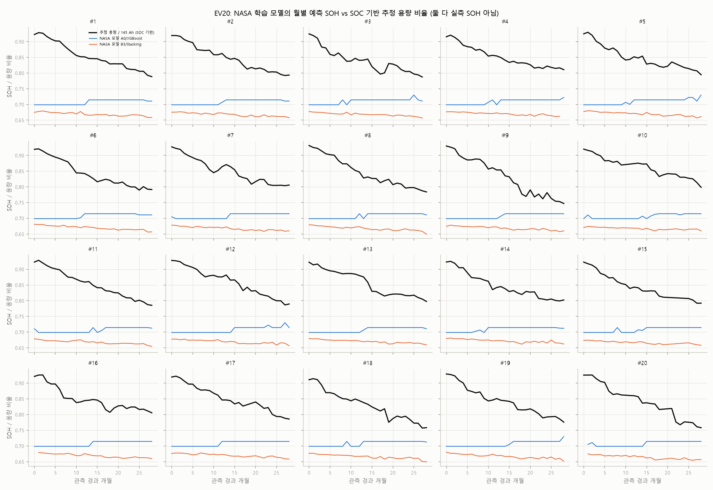
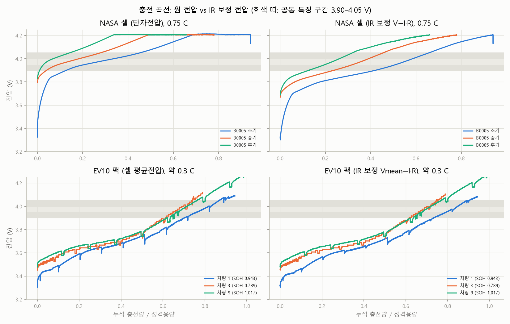
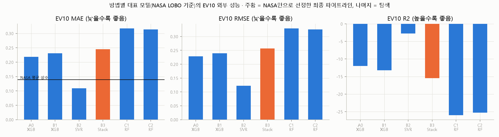
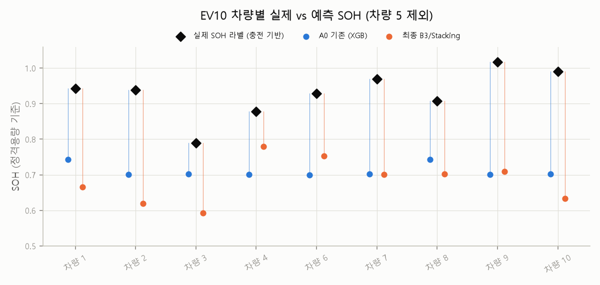
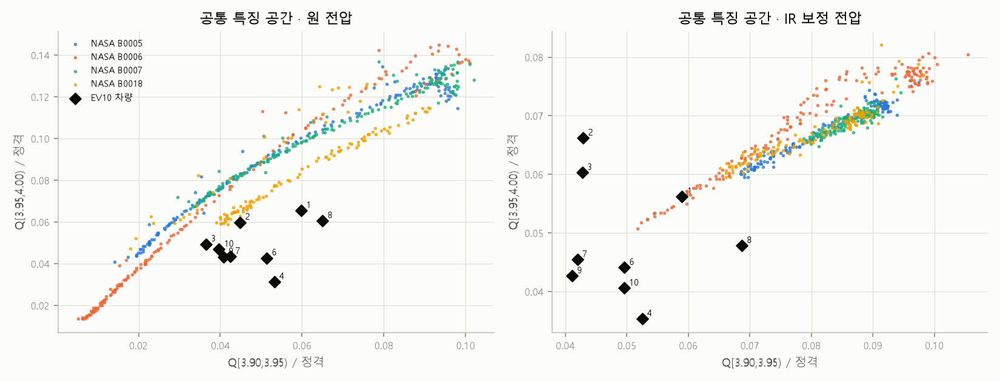

# NASA 기반 SOH 모델의 실제 전기차 적용 — 정규화·보정 확장 실험 보고서

작성일 2026-10-16. 수치는 모두 `python -m experiments.run_all`(전이 실험 포함) 최종 실행에서 만든 `results/transfer/` 파일에서 옮겼다.
- 전이 작업 전의 결과·문서·코드는 `results_archive/v2_before_transfer/`에 보관했다.
- 기존 NASA·EV10·EV20 결과가 이번 작업으로 바뀌지 않았는지는 `results/audit/vs_v2_before_transfer/`에서 대조했다(8.2절).
- 기본 과제 보고서는 [experiment_report.md](experiment_report.md)이다.

**읽는 규칙.**
- **성능 주장:** NASA 데이터만으로 고른 파이프라인 하나의 EV10 결과.
- **탐색:** 그 밖의 방법·모델 조합의 EV10 결과는 모두 탐색이며, EV10 결과를 보고 고른 값을 성능으로 주장하지 않는다.
- **EV10 라벨:** 학습·모델 선택·전압창·보정 상수 어디에도 쓰지 않았다.

## 0. 결론 요약 (Q1~Q5)

| 질문 | 답 (실측 결과) |
|---|---|
| **Q1.** NASA에서 어떤 모델이 SOH를 가장 정확히 예측하는가? | 신호 특징으로 현재 SOH를 추정할 때, 학습 데이터로 선정한 모델은 **LinearRegression, 시간순 MAE 0.0239**이다(Stacking 0.0143은 사후 최저, 직전 SOH 기준선 0.0046). 미학습 배터리에서는 학습 데이터로 선정했을 때 0.0374이다. 실차 공통 특징만 쓰도록 제한한 NASA 모델 중에서는 **B3/Stacking**이 LOBO 0.0215로 가장 좋다. |
| **Q2.** NASA 모델을 실차에 그대로 적용하면 오차는? | 기존 공통 특징(A0, 3.90–4.00 V 창) + XGBoost: **EV10 MAE 0.2187**, R² −12.0, Spearman −0.02 (9대). "NASA 평균 SOH 상수"를 예측값으로 쓰는 기준선(0.139)보다 나쁘다. |
| **Q3.** 정규화·보정으로 개선되는가? | **개선되지 않았다.** NASA만으로 고른 B3/Stacking은 **0.2451**이다. A0보다 +0.026(95 % CI −0.016~+0.065)으로 통계적으로 구분되지 않으며, 수치상 오히려 나쁘다. IR 보정(C1·C2)은 0.31~0.32로 더 나빠졌다. |
| **Q4.** 가장 큰 원인은? | **같은 전압창이 두 도메인에서 전혀 다른 충전 상태(SOC) 구간을 가리킨다.** NASA 원 전압의 3.90–4.00 V는 충전량 0.4~37 % 구간이고, IR 보정 후에도 11~65 %이다. EV10은 BMS SOC 55~90 %이다. 이는 화학계·셀 설계에 따른 OCV–SOC 곡선 차이로, 저항(C-rate) 보정으로는 해결되지 않는다. NASA는 C-rate와 온도가 각각 한 가지라, 조건에 따른 변화를 학습할 수도 없다. 라벨 정의 차이는 0.013 수준으로 작은 원인이다. |
| **Q5.** EV20 장기 기록에도 적용할 수 있는가? | 입력(평균 셀 전압 = 팩 전압/90, 전류, 충전 Ah)은 있고 세션의 24~36 %가 전압창을 덮는다. 하지만 B3/Stacking 예측은 평균 0.67로, 추정 용량 비율 0.85와 수준이 다르다. 월별 추세는 20대 모두 같은 방향(Spearman 중앙값 0.91)이지만 감소 기울기가 약 1/8에 그친다. A0는 반대 방향이다. **SOH 추정값으로는 쓸 수 없고**, 정답 SOH가 없어 검증할 수도 없다. |

## 1. 연구 범위와 원칙
- 이번 작업은 기본 과제(NASA 4셀, 회귀 4종 + Stacking, SOH·RUL·Small Data)의 확장이며, 기본 과제의 코드와 결과는 그대로 두었다.
- EV10·EV20 전용 모델은 새로 학습하지 않았다. 모든 예측은 NASA로 학습한 모델이 낸다.
- 공정 비교: 전이 실험의 모델은 **학습과 평가에 같은 입력 특징**만 쓴다. 기본 NASA 모델(14개 특징)과 전이 모델(공통 특징 1~5개)은 입력이 다르다(2.2절).

## 2. NASA와 EV10의 차이 (실측 확인)

### 2.1 데이터 조건 (`polarization_c_rate.csv`, `ev10_transfer_features.csv`)
| 항목 | NASA (B0005/6/7/18) | EV10 (차량 9대 평가) |
|---|---|---|
| 대상 | 단일 셀 | 팩 84~108직렬, NCM |
| 기준용량 | 정격 2.0 Ah | 차량별 100~234 Ah |
| 충전율 | 0.75 C (1.5 A CC 고정) | 전압창 내 충전량 가중 0.26~0.33 C |
| 전압 | 셀 단자전압 | 셀 평균전압 Vmean |
| 측정 저항 | 0.076~0.098 Ω (충전 시작 전압 점프, 표본 약 2.5 s) | 0.1~0.7 mΩ (팩 전류 기준, 전류 계단 52~631개 중앙값, 표본 1 s) |
| 충전 전류에서의 IR 강하 | **0.115~0.148 V** | **0.006~0.027 V** |
| R × 정격용량 | 0.153~0.197 Ω·Ah | 0.017~0.088 Ω·Ah |
| SOH | 방전 용량 / 2.0 Ah | 기록된 충전 Ah / Cn |
| 온도·임피던스 | 있음 | 없음 |
| 라벨 수 | 636 방전 Cycle | 10 (평가 9) |

### 2.2 기본 NASA 모델의 입력은 실차에 쓸 수 있는가
| 기본 특징 (14개) | EV10 | 이유 |
|---|---|---|
| CC 시간, 3.9→4.1 V 도달 시간 | ✗ | 충전 전류에 비례하는 값이라 C-rate가 다르면 의미가 다르다. 전류로 나누면 결국 전압창 충전량(A0·B 계열)이 된다 |
| CV 시간, 충전 시작 전압 | ✗ | 차량 충전기 프로파일과 시작 SOC가 제각각이다 |
| 충전 온도 3종 | ✗ | EV10에 온도가 없다 |
| dQ/dV 최댓값과 그 전압 (3.9–4.2 V) | △ | EV10 차량 1은 4.09 V, 차량 5는 3.99 V까지만 기록되어 4.2 V까지 덮지 못한다 |
| Re, Rct (EIS) | ✗ | EV10에 EIS가 없다 |
| 방전 번호 | ✗ | 실차 사이클 수 기록이 없다 |

따라서 실차 전이는 **충전 곡선의 전압창 충전량 계열 특징만으로** 따로 학습한 NASA 모델로 수행했다.

### 2.3 사전에 기록한 EV10 문제
- 라벨이 차량당 1개, 총 10개다.
- 차량 5는 README(174 Ah, 82.21 %)와 파일(147 Ah, 97.31 %)이 불일치해 제외했다. 게다가 Vmean 최대가 3.993 V라 모든 방법에서 특징이 없다.
- 차량 2(4–100 %), 3(3–99 %), 6(1–99 %), 8(0–99 %)은 기록 SOC가 0–100 % 전체가 아니다.
- 라벨(ΣQ/Cn)과 특징(창 충전량/Cn)은 같은 충전 기록에서 나와 구조적으로 종속된다([experiment_report.md](experiment_report.md) 6.1절).

## 3. 정규화·보정 방법의 타당성 검토와 설계

### 3.1 방법 (`src/features/transfer_features.py`, EV10 평가 전에 고정)
| 방법 | 전압 | 특징 | 근거 |
|---|---|---|---|
| A0 | 원 전압 | Q[3.90,4.00)/C정격 | 기존 Baseline |
| B1 | 원 전압 | Q 50 mV 구간 3개(3.90–4.05 V)/C정격 | 같은 전압 구간의 증분용량 프로파일 |
| B2 | 원 전압 | 구간 비율 Q[3.95,4.00)/Q[3.90,3.95), Q[4.00,4.05)/Q[3.90,3.95) | 정격용량과 무관한 곡선 모양(기울기) 특징 |
| B3 | 원 전압 | B1 + B2 | |
| C1 | **V − I·R** | B1 구간 | 실측 저항에 의한 IR 강하만 제거 |
| C2 | V − I·R | B1 + B2 | |

- **용량 정규화:** Q_norm = Q_window / C_rated. 단위를 맞출 뿐, 화학계나 충전 조건의 차이는 없애지 못한다.
- **IR 보정의 근거:** 저항은 각 기록에서 직접 측정했다(NASA: 그 충전 Cycle의 시작 전압 점프 ΔV/ΔI, EV10: 그 차량 기록의 전류 계단 ΔV/ΔI 중앙값). 임의 상수는 쓰지 않았다. 확산 같은 느린 분극은 보정하지 못한다.
- **검토했지만 적용하지 않은 방법:**
  - *C-rate를 입력에 넣기:* NASA 학습 데이터의 C-rate가 0.75 C 하나뿐이라, 모델이 C-rate의 영향을 배울 수 없다.
  - *OCV–SOC 보정:* EV10은 차량마다 SOC_OCV 표(8~13점)가 있지만, NASA에는 OCV 표도 기준 SOC도 없다. NASA 쪽에 대응하는 기준을 만들 수 없어 공통 보정으로 쓰지 못했다. EV10 내부 진단(3.3절)에만 사용했다.
  - *전압이나 SOH에 상수 곱하기:* 물리적 근거가 없어 쓰지 않았다.
- **시도하지 않은 전압창:** 3.90 V 아래는 NASA 충전 시작 전압(0.75 C에서 3.8~3.9 V)에 막혀 덮지 못하고, 4.05 V 위는 EV10 차량 1(최대 4.09 V)이 덮지 못한다.

### 3.2 같은 전압창이 가리키는 충전 위치 (`window_position.csv`, 라벨 미사용 진단)
NASA는 방전 종료 후 충전한 누적 비율(%), EV10은 구간 SOC 끝점 사이를 선형 보간한 BMS SOC(%)이다.

| | 3.90 V 도달 | 4.00 V 도달 |
|---|---|---|
| NASA 원 전압 (4셀 × 초기/중기/후기) | 0.4~13.9 % | 3.8~36.8 % |
| NASA IR 보정 | 10.8~46.8 % | 28.8~64.7 % |
| EV10 원 전압 (9대) | 54.6~79.0 % | 64.3~87.8 % |
| EV10 IR 보정 | 56.4~80.0 % | 64.9~90.2 % |

- NASA의 3.90–4.00 V는 충전 초반(분극으로 전압이 높게 뜬 구간)이고, EV10은 충전 후반이다.
- IR 보정으로 NASA 구간이 20~35 %p 뒤로 이동하지만, EV10과는 여전히 겹치지 않는다.
- NASA는 노화가 진행될수록 같은 전압에 더 일찍 도달한다(초기 → 후기). 모델은 바로 이 관계를 배운다. 그러나 EV10에서는 같은 특징값이 다른 SOC 구간의 정보라서, 이 관계가 그대로 옮겨지지 않는다.

### 3.3 EV10 OCV 대비 잔여 분극 (`ev10_ocv_residual.csv`, EV10만)
- Vmean − OCV(SOC) 중앙값은 차량별로 −0.035~+0.070 V이다. IR 보정 후에는 −0.041~+0.048 V이다.
- 차량 1·7·10에서는 IR 보정이 잔차를 0.02~0.03 V 줄였다. 그러나 차량 2·4에서는 원래부터 음수(측정 전압 < OCV)라, SOC 보간이나 OCV 표 자체의 오차가 함께 섞여 있다.
- NASA에는 같은 진단을 할 OCV 자료가 없다.

### 3.4 SOH 라벨 정의 (`label_definition_analysis.csv`, `transfer_summary.json`)
- **NASA 쪽 비교:** NASA 충전 기반 SOH(직전 충전 Ah / 2.0, EV10과 같은 정의)와 방전 기반 SOH를 624행에서 비교했다.
  - 평균 차이 +0.0107, MAE 0.0128, Spearman 0.994.
  - 충전 Ah / 직전 방전 Ah 중앙값 1.011.
  - **NASA에서는 두 정의가 1 % 수준으로만 다르다.**
- **EV10 쪽 한계:** EV10 라벨은 기록 SOC 범위의 충전량이라 0–100 % 전 용량과 다를 수 있다. 4대는 범위가 1~4 %p 부족하다.
- **두 정의를 동일하게 볼 수 없는 이유:** EV10의 방전 용량은 측정된 적이 없어 변환을 검증할 수 없다. 그래서 두 라벨을 같은 정답으로 가정하지 않았다. 대신 4.4절에서 라벨 정의를 맞춘 분석과 민감도 분석을 따로 했다.

## 4. 실험 결과

### 4.1 NASA 내부 성능 — 공통 특징만 사용 (`nasa_internal_scores.csv`)
| 방법 | 모델 | LOBO MAE | LOBO R² | 시간순 MAE | 시간순 R² | 학습시간 (s) |
|---|---|---:|---:|---:|---:|---:|
| A0 | XGBoost (방법 대표) | 0.0302 | 0.856 | 0.0460 | −0.74 | 0.11 |
| A0 | Stacking | 0.0307 | 0.863 | 0.0184 | 0.70 | 1.8 |
| B1 | XGBoost (대표) | 0.0253 | 0.887 | 0.0410 | −0.31 | 0.11 |
| B2 | SVR (대표) | 0.0415 | 0.690 | 0.0370 | −0.45 | 0.01 |
| **B3** | **Stacking (최종 선정)** | **0.0215** | **0.916** | **0.0137** | **0.83** | 2.0 |
| B3 | LinearRegression | 0.0236 | 0.919 | 0.0161 | 0.78 | 0.005 |
| C1 | RandomForest (대표) | 0.0362 | 0.752 | 0.0309 | 0.13 | 0.27 |
| C2 | RandomForest (대표) | 0.0371 | 0.746 | 0.0309 | 0.14 | 0.26 |

- 30개 조합 전체는 CSV에 있다.
- 선정 규칙: NASA 4셀 leave-one-battery-out 평균 MAE가 최소인 (방법, 모델)이다(`selection.json`).
- 해당 방법의 특징이 하나라도 없는 NASA 행(유효하지 않은 충전 12행)은 학습에서 뺐다. 기존 EV10 Baseline과 같은 규칙이며, 이 규칙으로 기존 결과가 정확히 재현된다(4.2절).
- NASA 안에서는 공통 특징만으로도 기본 14개 특징 모델(LOBO 선정 0.0374)보다 좋다.

### 4.2 실험 A — 기존 Baseline 재현 (`normalization_comparison.csv`)
- A0 + XGBoost(NASA LOBO 대표) → **EV10 MAE 0.2187, RMSE 0.2286, R² −12.0, Spearman −0.02.** 기존 값과 정확히 같다.
- 개발 중 첫 실행에서는 유효하지 않은 충전 12행을 XGBoost가 결측으로 직접 처리해 0.2167이 나왔다. 특징값은 기존과 같고(최대 차이 6×10⁻¹⁷), 차이는 그 12행에서만 왔다.
- 기존 실험과 같은 규칙(해당 행 제외)으로 맞춘 뒤 재실행했다. 이 규칙은 EV10 결과를 본 뒤에 바꾼 것이므로, 바꾸기 전의 전체 결과를 `results_archive/transfer_dev_keepNaN/`에 보관했다.

### 4.3 실험 B·C·D — 정규화·보정 전후 비교
**최종 선정(NASA만) vs 기존 vs 기준선** (`normalization_comparison.csv`, `ev10_reference_baselines.csv`, `improvement_bootstrap.csv`)

| 구분 | 파이프라인 | EV10 MAE | RMSE | R² | Spearman |
|---|---|---:|---:|---:|---:|
| A 기존 | A0 / XGBoost | 0.2187 | 0.2286 | −12.0 | −0.02 |
| **B 최종 선정** | **B3 / Stacking** | **0.2451** | 0.2570 | −15.4 | 0.00 |
| 기준선 (EV 라벨 미사용) | NASA 평균 SOH 상수 | 0.1388 | 0.1522 | −4.8 | — |
| 참고 (EV 라벨 사용) | 다른 차량 라벨 평균 (LOO) | 0.0533 | 0.0713 | −0.27 | — |

- **개선율(A → B):** −12.0 %(악화). 차이 +0.026, 차량 단위 쌍대 부트스트랩(10,000회) 95 % CI −0.016~+0.065. B가 더 나은 부트스트랩 표본 비율은 10.4 %이다.
- **NASA 평균 상수 대비:** +0.106(95 % CI +0.068~+0.144)으로 유의하게 나쁘다.

**방법별 대표 모델의 EV10 성능** (탐색, NASA LOBO로 고른 각 방법의 대표 모델)

| 방법 | 대표 모델 | EV10 MAE | R² | Spearman | 성격 |
|---|---|---:|---:|---:|---|
| A0 | XGBoost | 0.219 | −12.0 | −0.02 | 기존 Baseline |
| B1 | XGBoost | 0.231 | −13.3 | −0.17 | 탐색 |
| B2 | SVR | 0.109 | −2.7 | 0.05 | 탐색 |
| B3 | Stacking | 0.245 | −15.4 | 0.00 | **최종 선정** |
| C1 (IR 보정) | RandomForest | 0.318 | −26.0 | −0.46 | 탐색 |
| C2 (IR 보정) | RandomForest | 0.314 | −25.3 | −0.52 | 탐색 |

**탐색 결과 해석(사후 비교, 성능 주장 아님):**
- 30개 조합 중 EV10 MAE가 가장 낮은 것은 B2 계열(XGB 0.067, LR 0.068, RF 0.079)이다. 그러나 Spearman은 −0.27~−0.78이다. 비율 특징이 예측을 평균 쪽으로 몰아 MAE만 줄였을 뿐, 차량 간 SOH 순서는 맞히지 못했다.
- B2는 NASA LOBO에서 가장 나쁜 계열(0.042~0.087)이라, NASA만으로는 고를 수 없는 방법이다.
- **IR 보정은 오히려 나빠졌다.** 보정으로 NASA 전압창이 SOC 기준으로 크게 이동하자, 특징 공간에서 EV10이 NASA 분포 밖으로 더 멀어졌다(4.5절).

**차량별 결과** (`ev10_vehicle_predictions.csv`, 그림 `transfer_vehicle_predictions.png`)

| 차량 | 실제 SOH | A0 예측 (오차) | B3 예측 (오차) |
|---|---:|---|---|
| 1 | 0.943 | 0.743 (−0.200) | 0.666 (−0.277) |
| 2 | 0.938 | 0.701 (−0.237) | 0.620 (−0.319) |
| 3 | 0.789 | 0.703 (−0.086) | 0.593 (−0.196) |
| 4 | 0.878 | 0.700 (−0.178) | 0.780 (−0.098) |
| 6 | 0.929 | 0.699 (−0.230) | 0.752 (−0.177) |
| 7 | 0.970 | 0.703 (−0.267) | 0.701 (−0.269) |
| 8 | 0.908 | 0.743 (−0.165) | 0.703 (−0.205) |
| 9 | 1.017 | 0.700 (−0.317) | 0.709 (−0.308) |
| 10 | 0.991 | 0.703 (−0.288) | 0.634 (−0.357) |

- 두 파이프라인 모두 **9대 전부를 과소 예측**한다(−0.09 ~ −0.36). A0는 거의 상수(0.70~0.74)를 내고, B3는 0.59~0.78로 변동이 생겼지만 그 변동이 실제 SOH 순서와 무관하다.
- B3가 A0보다 나아진 차량은 4·6·9(3대), 나빠진 차량은 6대다.

### 4.4 라벨 정의를 맞춘 분석 (`label_definition_analysis.csv`, 사전 정의한 보조 분석)
| 분석 | 선정 (NASA만) | EV10 MAE | Spearman |
|---|---|---:|---:|
| 주 분석: NASA 방전 기반 soh_rated | B3/Stacking | 0.245 | 0.00 |
| NASA 라벨을 충전 기반(EV10과 같은 정의)으로 바꾸고 다시 선정 | B3/Stacking | 0.236 | 0.07 |
| 민감도: EV10 라벨을 기록 SOC 범위로 나눠 0–100 % 환산 | (주 분석 예측) | 0.256 | −0.02 |

라벨 정의를 맞춰도 0.009만 줄어든다. 라벨 정의 차이는 0.2 수준 오차의 주원인이 아니다.

### 4.5 도메인 이동 (라벨 미사용 진단, `domain_shift_label_free.csv`)
| 방법 | EV10이 NASA 특징 범위 안에 있는 차량 | 최근접 거리 EV10→NASA (중앙값) | 참고: NASA 미학습 셀→나머지 |
|---|---:|---:|---:|
| A0 | 9/9 | 0.001 | 0.003 |
| B1 | 9/9 | 0.99 | 0.15 |
| B2 | 3/9 | 0.55 | 0.05 |
| B3 (최종) | **3/9** | 1.49 | 0.24 |
| C1 | 1/9 | 2.60 | 0.16 |
| C2 | 1/9 | 4.09 | 0.24 |

거리는 NASA 기준 표준화 공간에서 쟀다.
- 특징을 늘리거나 보정할수록 NASA 안에서는 성능이 좋아지지만, EV10은 NASA 분포에서 더 멀어진다.
- NASA만으로 선정한 B3는 EV10 9대 중 6대에서 외삽한다.
- 이 진단은 EV10 라벨 없이 계산할 수 있으므로, 앞으로는 사전 선정 규칙에 포함하는 것이 타당하다(7절). 이번 선정에는 미리 정하지 않았으므로 쓰지 않았다.

## 5. EV20 확장 검토 (`results/transfer/ev20/`)

### 5.1 입력 존재 여부와 측정 조건 (`ev20_signal_check.csv`, `ev20_window_coverage.csv`)
| 필요 입력 | EV20 | 비고 |
|---|---|---|
| 평균 셀 전압 | 팩 전압 / 90 | (최고+최저 셀)/2와의 중앙 차이 −7.3~+4.8 mV |
| 충전 전류, 충전 Ah | 있음 | 표본 간격 8~10 s (EV10 1 s) |
| 저항 (IR 보정용) | 전류 계단 2,039~5,988개, 중앙 0.38~0.40 mΩ | 최종 방법(B3)은 IR 보정을 쓰지 않음 |
| 정격용량 | 공칭 145 Ah | 차량별 실측 아님 |
| 독립 측정 SOH | **없음** | 비교 대상은 SOC 기반 추정 용량 / 145 |

- 세션 필터는 기존 EV20 규칙(10 s 간격 분할, 100행 이상, SOC 이상 변화 없음, 양(+) 전류 없음)이다.
- 3.90–4.05 V를 모두 덮는 세션은 차량별 24~29 %(B3), A0 창은 31~36 %다.

### 5.2 NASA 모델의 월별 예측 vs 추정 용량 추세 (`ev20_trend_summary.csv`, `ev20_trend_comparison.csv`)
| 파이프라인 | 차량 | 월별 Spearman 중앙값 (양수 차량) | 예측 기울기 중앙값 (/년) | 추정 용량 비율 기울기 중앙값 (/년) | 평균 예측 | 평균 추정 용량 비율 |
|---|---:|---:|---:|---:|---:|---:|
| B3 / Stacking (최종) | 20 | **+0.91** (20/20) | −0.0075 | −0.0569 | 0.668 | 0.848 |
| A0 / XGBoost | 20 | −0.79 (0/20) | +0.0092 | −0.0569 | 0.708 | 0.848 |

- **B3:** 시간에 따른 감소 방향은 20대 모두 추정 용량과 같다. 그러나 수준이 약 0.18 낮고, 28개월 변동폭은 차량별 0.014~0.030에 불과하다(추정 용량 비율은 약 0.13 감소). 감도가 약 1/8이라 SOH 값으로 쓸 수 없다.
- **A0:** XGBoost의 계단형 출력(변동폭 0.016~0.031) 때문에 시간이 갈수록 예측이 **올라가는** 반대 방향이 된다.
- **해석의 한계:** EV20의 비교 대상(추정 용량)도 같은 충전 기록과 BMS SOC에서 나온 추정치다. 따라서 B3와의 방향 일치는 "독립 검증"이 아니라 같은 데이터에서 나온 두 지표가 함께 움직인다는 뜻이다.

### 5.3 판정
- **입력은 있지만 SOH 추정에는 적용할 수 없다.** EV10 정규화 방법(B3)이 EV20에서 계산은 되지만, EV10과 같은 원인(전압창의 SOC 위치 차이)으로 수준이 0.18 낮고 감도가 1/8이다.
- 보정 계수를 맞추려면 실측 SOH 라벨이 필요한데, EV20에는 없다.
- EV20 전용 회귀 모델은 만들지 않았다.

## 6. 그래프
- `figures/transfer_charge_curves.png`: NASA·EV10 충전 곡선, 원 전압과 IR 보정 전압, 공통 전압 구간 표시.
- `figures/transfer_metrics_comparison.png`: 방법별 대표 모델의 EV10 MAE·RMSE·R²(주황 = 최종 선정, 나머지 = 탐색).
- `figures/transfer_vehicle_predictions.png`: 차량별 실제 vs A0·최종 예측.
- `figures/transfer_feature_space.png`: 원 전압과 IR 보정 전압에서 NASA 4셀과 EV10의 공통 특징 분포.
- `ev20/figures/ev20_nasa_pred_vs_capacity.png`: EV20 월별 예측과 추정 용량 비율.

## 7. 한계와 다음 단계
- **표본:** EV10 평가 차량은 9대이고, 라벨이 충전 기록에서 계산되어 특징과 종속된다. 부트스트랩 CI가 넓어 작은 개선이나 악화는 판별할 수 없다.
- **NASA의 조건 다양성 부족:** C-rate(0.75 C)와 주변 온도(24 ℃)가 각각 하나뿐이라 충전 조건이 모델에 반영되지 않는다. 화학계도 README에 기재되어 있지 않다.
- **보정의 범위:** IR 보정은 빠른 분극만 다룬다. 핵심 원인인 OCV–SOC 곡선 차이는 NASA에 OCV 자료가 없어 보정할 수 없다.
- **선정 규칙의 약점:** NASA LOBO는 도메인 이동을 측정하지 못해, NASA 분포 밖으로 가장 멀리 나가는 특징 조합(B3)을 골랐다. 다음 실험에서는 라벨 없이 계산되는 도메인 이동 지표(4.5절)를 **사전 등록된** 제약으로 넣어야 한다.
- **필요한 데이터:**
  1. EV와 같은 화학계(NCM)·비슷한 C-rate의 셀 노화 데이터(OCV 시험 포함)
  2. 충전 기록과 독립적으로 측정한 팩 용량 라벨
  3. NASA 쪽 저율(C/20) OCV 측정

## 8. 재현성과 검증

### 8.1 실행 (`results/runtime.json`)
`python -m experiments.run_all`은 전이 실험(`transfer_experiments`), EV20 확장(`transfer_ev20`), v1·전이 전 결과와의 비교, pytest까지 모두 실행한다.

### 8.2 기존 결과 보존 (`results/audit/vs_v2_before_transfer/before_after_summary.csv`)
전이 작업 전 결과(v2)와 비교했을 때, 9개 표(NASA A·B·C·E·보조·미래·RUL, EV10, EV20 추세)의 276행이 **모두 같고**(변경 0행), 추가되거나 빠진 행도 없다. 기본 과제 결과는 이번 확장으로 바뀌지 않았다.

### 8.3 자동 테스트 (`tests/test_transfer.py`, 8개 추가)
| 테스트 | 확인 내용 |
|---|---|
| 알려진 직선 충전 곡선 | 구간 충전량과 비율이 해석적 값과 일치 |
| 비율 특징 | 용량 규모(×50)를 바꿔도 불변 |
| IR 보정 | 전압을 I·R만큼 이동한 곡선의 특징과 동일 |
| 전류 계단 저항 | 합성 데이터에서 0.5 mΩ 복원 |
| NASA 시작 전압 점프 저항 | 같은 Cycle 안에서 약 0.085 Ω |
| EV10 저항·곡선 | SOH 라벨을 바꿔도 불변 |
| 모델 선정 | NASA 데이터만 입력. EV10 라벨을 섞어도 EV10 예측이 동일 |
| 쌍대 부트스트랩 | 부호·신뢰구간·개선율 계산 |

### 8.4 최종 실행 확인
| 단계 | 시간 (s) | 결과 |
|---|---:|---|
| Stacking OOF 진단 | 3 | 성공 |
| NASA 기본 실험 | 355 | 성공 |
| EV20 분석 | 132 | 성공 |
| EV10 외부 평가(기존) | 28 | 성공 |
| **전이 실험 (NASA 선정 + EV10 평가 + 진단)** | 171 | 성공 |
| **EV20 확장 검토** | 122 | 성공 |
| v1 비교 / 전이 전 비교 | 1 / 1 | 성공 |
| pytest | 20 | **42 passed** (기존 34 + 전이 8) |
| 합계 | 832 | |

재현: `.venv\Scripts\python -m experiments.run_all`
